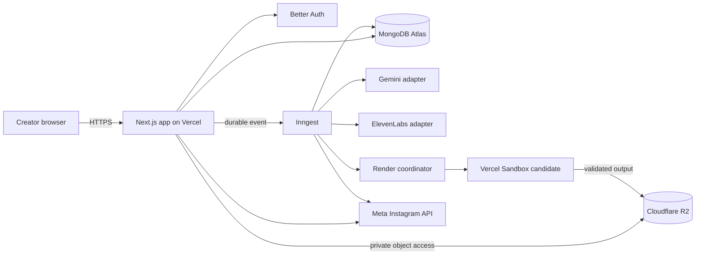

# ClairoVid.ai — V1 System Architecture

Version: 1.0  
Date: October 23, 2026  
Status: Architecture proposal aligned to the approved public V1 PRD and pipeline design; implementation decisions that require a benchmark or account configuration are called out below.  
Product baseline: [ClairoVid.ai Final V1 PRD](./Product%20Requirements%20Document%20-%20AI%20Educational%20Video%20Generation%20SaaS.md)  
Pipeline baseline: [ClairoVid.ai Pipeline Technical Design](./ClairoVid.ai%20-%20Pipeline%20Technical%20Design.md)

## 1. Purpose and scope

This document describes the production application architecture for ClairoVid.ai V1. It carries the proven local video pipeline into a public web application for individual creators. The target workflow is: create an idea, approve a combined script and storyboard, generate and review a video, then download or publish/schedule it to the creator’s eligible Instagram account.

The architecture preserves the PRD decisions: Next.js App Router with TypeScript and Node.js server endpoints, Better Auth, MongoDB Atlas, private Cloudflare R2 storage, Inngest for durable workflows, Remotion for rendering, Gemini for planning/revisions, ElevenLabs for speech, and Meta’s Instagram API for publishing. Vercel is the initial application host; Vercel Sandbox is the hosted-rendering candidate and must pass a benchmark before production use.

This is a system design, not evidence that the production application exists or has passed launch checks. The prototype notes report working local generation and recovery behavior, while the referenced evidence files are not in the workspace. Phase 0’s review of both Indian English narrator presets remains open. The full system must not treat these as completed launch gates.

### V1 boundary

Included: public individual accounts with email verification; private personal workspaces; educational video projects and immutable versions; planning, review, generation, revisions, preview/download; one user-owned Instagram connection; publishing and scheduling; recovery, deletion, backups, and operational controls.

Excluded: shared workspaces, enterprise administration, user-facing billing/credits, arbitrary user-supplied code, voice cloning, background music, non-Instagram destinations, and multi-provider routing. Download remains available without Instagram authorization.

## 2. Architecture at a glance

The web request layer performs authentication, ownership checks, input validation, and short database operations. It does not hold a request open for AI generation or video rendering. Inngest owns durable workflow execution and retries; MongoDB remains the application record of project and job state. The renderer receives a versioned, validated render manifest and approved assets, and returns a validated MP4 to private R2 storage. Instagram actions are separate workflows tied to an immutable approved video version.

### Trust boundaries

1. **Browser:** untrusted input; may only access data and actions authorized for the current session.
2. **Next.js server:** trusted application boundary; validates sessions, ownership, schemas, rate limits, and state transitions.
3. **Inngest:** trusted workflow boundary; receives opaque identifiers and reloads authorized state from MongoDB rather than trusting client-supplied plans.
4. **AI providers:** external processors; receive only the minimum required content and never receive credentials, ownership authority, or arbitrary executable instructions.
5. **Render sandbox:** isolated compute for trusted versioned application code; treats plan data and assets as untrusted; has no permission to access other owners’ objects.
6. **R2 and Meta:** separate storage and publication boundaries; R2 stays private, and Meta access is per creator connection.

## 3. Runtime components and responsibilities

| Component | Responsibility | Must not do |
|---|---|---|
| Next.js App Router | Dashboard, authenticated server actions/routes, OAuth callbacks, validation, user-facing status | Run a long video render inside a request handler |
| Better Auth | Email/password sessions, verification, session lifecycle, account recovery | Replace project-level ownership authorization |
| MongoDB Atlas | User-owned project state, immutable versions, jobs, schedules, connection metadata, outbox records | Store large binary audio/video blobs |
| Cloudflare R2 | Private audio, alignment, preview, and final media artifacts | Act as an authorization system by object-path naming alone |
| Inngest | Durable generation, render, cleanup, and publishing workflows | Become the only source of application state |
| Gemini adapter | Brainstorming, structured script/storyboard plans, constrained revisions | Emit executable React/JavaScript or assign owners/approvals |
| ElevenLabs adapter | Narration synthesis and supported alignment output | Decide semantic visual timing or silently replace unavailable voices |
| Remotion renderer | Deterministically draw approved components and audio timeline | Call AI providers or execute model-generated code |
| Render coordinator | Create isolated render execution, poll/collect output, validate and store it | Assume ephemeral sandbox files survive teardown |
| Instagram adapter | OAuth integration, media publishing, status reconciliation | Use a shared platform credential as a creator’s authorization |

Keep pipeline contracts independent of Next.js request/response objects. App routes call application services that validate and persist commands. Inngest functions call the same domain services or dedicated worker functions. Avoid a second Express service in V1; the PRD chooses one Next.js codebase with Node.js runtime endpoints.

## 4. Main request and workflow sequences

### 4.1 Create and approve a storyboard

1. The browser submits an idea, optional notes/audience, and a selected voice preset to an authenticated endpoint.
2. The server verifies the session, enforces per-account/global limits, creates an owner-scoped project or draft, and stores an idempotency key for the command.
3. The application writes a planning job and an outbox event in one MongoDB transaction. A dispatcher sends the event to Inngest; duplicate delivery is safe.
4. The planner workflow loads the project using both owner and project identifiers, calls Gemini through the server-side adapter, validates the structured result against the versioned schema and allowed component registry, then stores a draft storyboard revision.
5. The browser reads durable job state and retrieves the saved storyboard. The creator edits/revises until satisfied.
6. Approval is a separate authenticated command. The server computes a canonical hash of the approved plan and records the actor, timestamp, and hash. Any subsequent content or timing-affecting plan change creates a new revision and requires approval again.

### 4.2 Generate a video

1. The creator requests generation for an approved storyboard hash. The server verifies the current user owns the project and that the approval hash matches the selected immutable version.
2. A compare-and-set transition reserves the project’s single active generation slot. The app creates a VideoVersion, GenerationJob, and outbox event transactionally.
3. The Inngest workflow obtains approved plan data from MongoDB. For each scene, it reuses compatible validated speech artifacts or calls ElevenLabs; it stores audio and alignment in private R2, then records checksums and provider provenance.
4. The workflow validates alignment, compiles captions and visual cues to a deterministic timeline, then writes an immutable render manifest. Unsupported components, unresolved cues, or stale approvals stop the job as actionable errors.
5. The render coordinator starts an isolated Remotion render. It records the sandbox identity and polls in bounded durable steps. A browser closing has no effect on the job.
6. The workflow validates the output media metadata, duration, streams, frame rate, dimensions, and QA report. It transfers the finished artifact to private R2 and confirms object metadata/checksum before marking the video version ready for review.
7. The UI displays progress from durable job state and then a private preview/download capability. The previous successful video remains available if a new revision fails.
8. A human approves the resulting video version for publication. Publication can only reference that approved immutable version.

### 4.3 Revise without unnecessary regeneration

Revision interpretation produces a candidate structured change and a diff, never executable code. Each change type has explicit invalidation dependencies. A visual-only adjustment can reuse narration and alignment if its inputs remain identical; a spoken-text edit invalidates affected speech and all downstream timing/render outputs; a voice change invalidates all speech/alignment and final output. New plan versions require approval where the explanation or storyboard changes. Preserve the last valid output and any existing schedule until the replacement version is approved and explicitly selected.

## 5. Data model and indexes

All user-owned documents carry an immutable `ownerId`. Child records also carry `projectId` and, where applicable, `versionId`. Every read, mutation, worker load, and object-signing operation applies ownership in the query predicate. IDs are opaque identifiers, not authorization secrets. Use transactions for multi-record state changes where supported; otherwise use explicit idempotent state machines and reconciliation.

| Collection | Important fields | Purpose |
|---|---|---|
| `users` | `_id`, auth reference, email verification/status, timezone, preferred voice preset, created/updated timestamps | User profile and defaults; no provider secrets |
| `projects` | `_id`, `ownerId`, title, active draft/version IDs, latest successful video ID, active job ID, archived/deleted markers, timestamps | User’s private project and workflow pointers |
| `storyboardVersions` | `_id`, `ownerId`, `projectId`, parent version, schema version, plan JSON, canonical hash, approval record, created by/time | Immutable approved or draft plans and revision history |
| `videoVersions` | `_id`, `ownerId`, `projectId`, storyboard version/hash, voice/model IDs, render settings, artifact references, QA results, review/publish approval state | Reproducible generated outputs |
| `generationJobs` | `_id`, `ownerId`, `projectId`, `videoVersionId`, idempotency key, state, stage, progress, attempt counts, safe error code, timestamps, cancellation state | Durable user-visible generation state |
| `artifacts` | `_id`, `ownerId`, `projectId`, `versionId`, kind, private R2 key, content type, byte length, checksum, provenance, lifecycle state | Metadata for binaries held in R2 |
| `conversations` | `_id`, `ownerId`, `projectId`, messages or references, retention timestamps | Private brainstorming and revision context; minimize retention/content copied to logs |
| `instagramConnections` | `_id`, `ownerId`, platform account ID, encrypted token envelope, scopes, expiry/check state, status | One creator’s encrypted Instagram authorization |
| `publishIntents` | `_id`, `ownerId`, `projectId`, `videoVersionId`, connection ID, caption, scheduled time/timezone, state, attempt/idempotency data, platform media/publish IDs | Post-now and scheduling lifecycle |
| `outboxEvents` | `_id`, aggregate type/ID, event type, payload reference, created/delivered timestamps, delivery count | Reliable database-to-Inngest dispatch |
| `idempotencyRecords` | owner, key, operation, request hash, result reference, expiry | Safe retry behavior for user commands and callbacks |

### Required indexes

- `projects`: `{ ownerId: 1, updatedAt: -1 }`; owner-scoped project listing.
- `projects`: unique `{ ownerId: 1, _id: 1 }` is redundant if `_id` is global; queries must still include `ownerId`.
- `storyboardVersions`: `{ ownerId: 1, projectId: 1, createdAt: -1 }` and unique `{ projectId: 1, _id: 1 }`.
- `videoVersions`: `{ ownerId: 1, projectId: 1, createdAt: -1 }`.
- `generationJobs`: `{ ownerId: 1, projectId: 1, createdAt: -1 }`; partial unique active-job constraint per project, implemented with a project reservation/compare-and-set if partial-state transitions make uniqueness impractical.
- `generationJobs`: unique `{ ownerId: 1, idempotencyKey: 1 }` for accepted user commands.
- `artifacts`: unique `{ ownerId: 1, versionId: 1, kind: 1, checksum: 1 }` where semantics allow; `{ ownerId: 1, projectId: 1, versionId: 1 }` for lookup.
- `instagramConnections`: unique `{ ownerId: 1 }` for the V1 one-connection limit; unique platform account identity as required to prevent the same destination from being attached to multiple creators, without exposing the other owner.
- `publishIntents`: `{ ownerId: 1, scheduledAt: 1, state: 1 }` for creator history; `{ state: 1, scheduledAt: 1 }` for due-work lookup.
- `outboxEvents`: `{ deliveredAt: 1, createdAt: 1 }` for dispatcher polling; unique event/aggregate key to prevent duplicate logical events.
- TTL indexes only for explicitly short-lived idempotency, OAuth state, and temporary preview records; never use TTL for primary user project data or audit/publishing history.

Confirm exact uniqueness/index definitions against Better Auth’s MongoDB adapter and actual query patterns before deployment. Apply indexes through versioned migrations and monitor index build completion.

## 6. API and authorization boundaries

All browser APIs require a verified, active session unless explicitly documented as a public auth or provider callback route. Validate request bodies with runtime schemas, enforce CSRF/origin protections on cookie-authenticated mutations, cap payload sizes, and return safe error codes without leaking internal provider output or another owner’s data.

Suggested route surface (exact paths may follow repository conventions):

| Route | Operation | Authorization and behavior |
|---|---|---|
| `POST /api/projects` | Create project/draft | Authenticated owner; idempotent; validate title/idea and limits |
| `GET /api/projects` | List projects | Current owner only; cursor pagination |
| `GET/PATCH/DELETE /api/projects/:projectId` | Read/update/archive/delete project | Every database query includes current `ownerId`; no mass assignment |
| `POST /api/projects/:projectId/brainstorm` | Ask planning assistant | Auth, ownership, request quotas; persist conversation within owner scope |
| `POST /api/projects/:projectId/storyboards` | Generate/revise storyboard | Auth, ownership, schema version, idempotency; dispatch durable job |
| `POST /api/projects/:projectId/storyboards/:versionId/approve` | Approve plan | Auth, owner, current hash; server computes/stores hash |
| `POST /api/projects/:projectId/generations` | Start generation | Auth, owner, approved plan hash, active-job guard, idempotency |
| `GET /api/jobs/:jobId` | Poll status | Owner-scoped response; no cross-owner job existence leak |
| `POST /api/jobs/:jobId/cancel` | Request cancellation | Owner scoped; cancellation is cooperative and cannot undo provider work already underway |
| `POST /api/video-versions/:versionId/approve` | Approve video for publication | Auth and ownership; only validated ready output |
| `POST /api/artifacts/:artifactId/access` | Create short-lived preview/download URL | Owner check, allowed artifact kind, short expiry, audit event |
| `POST /api/instagram/connect` | Start OAuth | Authenticated user; server-generated state/nonce and PKCE if supported by the chosen flow |
| `GET /api/instagram/callback` | OAuth callback | Validate single-use state, bind to initiating user, exchange token server-side |
| `DELETE /api/instagram/connection` | Disconnect | Owner; revoke if supported; mark disconnected, remove encrypted credentials |
| `POST /api/publish-intents` | Publish now or schedule | Owner; approved version, eligible connection, validated caption/time |
| `POST /api/publish-intents/:intentId/cancel` | Cancel schedule | Owner; only while platform state allows safe cancellation |
| `POST /api/inngest` | Inngest event/function endpoint | Verify Inngest signature; no browser session assumed |
| `POST /api/webhooks/meta` | Optional verified platform callback | Verify platform signature and event authenticity; idempotent processing |

Do not trust owner/project/version IDs supplied by the browser without resolving them under the authenticated owner. Workers should receive a job ID and expected owner/project/version references, then reload and verify all references before acting. Return 404 for objects that do not belong to the caller where that prevents identifier enumeration.

### Authentication and session controls

Use Better Auth for verified public accounts, email verification, secure session cookies, sign-out, and recovery. Configure trusted origins, secure/HttpOnly/SameSite cookies, session rotation/revocation, password policy, and abuse controls. Email verification is required before generation and Instagram connection. Administrative credentials and provider secrets are never exposed to the browser. Account deletion disables sessions immediately and starts a durable deletion process.

## 7. Durable job dispatch and state machines

### Reliable dispatch

Avoid a dual-write where MongoDB says a job exists but Inngest never receives it. In one database transaction, create the job and an outbox event. A small dispatcher publishes pending events to Inngest, records successful delivery, and safely retries. Inngest event IDs and workflow steps should be deterministic/idempotent where supported. A reconciler scans old pending outbox records and jobs stuck beyond stage timeouts. Duplicate workflow delivery must converge on the same job/version rather than create duplicate provider calls or renders.

### Generation state

Keep user-facing job state separate from stage state and video review state:

- Job: `queued`, `running`, `needs-input`, `failed`, `cancel-requested`, `cancelled`, `completed`.
- Stage: `planning`, `speech`, `alignment`, `timeline`, `render`, `validation`, `upload`, `done` with per-stage `pending/running/succeeded/failed/skipped` and attempt metadata.
- Storyboard: `draft`, `awaiting-approval`, `approved`, `superseded`.
- Video: `generating`, `ready-for-review`, `approved`, `rejected`, `superseded`, `unavailable`.
- Publish intent: `scheduled`, `preparing`, `uploading`, `publishing`, `published`, `failed`, `unknown-outcome`, `cancelled`.

Only explicit domain transitions may update state. Use conditional updates with expected prior state and version. Terminal transitions are idempotent. Do not mark a job complete before the validated final object is durable in R2 and its artifact record is committed.

### Retry, timeout, and cancellation

Retry transient network/rate-limit/server failures with bounded exponential backoff and provider `Retry-After` when available. Do not retry invalid credentials, invalid input, policy rejections, unsupported models, or schema violations without correction. A timeout does not prove an external operation failed; record an uncertain outcome and query/reconcile when the provider supports status lookup. Provider calls may have incurred cost even if the client timed out. Avoid automatic speech retries until the implementation’s no-retry prototype behavior is intentionally reconciled with this target policy and duplicate-cost controls.

Cancellation marks intent immediately, prevents future stages, and asks active workers/renderers to stop. It cannot promise that an already-submitted provider request or Instagram publication is undone. Store any late result as an unreferenced artifact eligible for cleanup; do not allow it to advance a cancelled job or replace the last successful video.

## 8. Storage, media access, and deletion

MongoDB stores metadata and state; R2 stores binary audio, alignment/caption files where appropriate, preview frames, and final video. Use private buckets, server-side credentials, owner/project/version-scoped opaque object keys, checksums, content-length/type validation, and lifecycle cleanup. Object keys do not authorize reads.

For preview/download, the application authenticates the user, checks ownership and artifact state, then issues a short-lived signed URL or streams through an authorized endpoint if signed delivery is unsuitable. Never expose permanent public URLs. Prevent arbitrary object-key input and path traversal. Use upload constraints and content type allowlists; validate the actual encoded media rather than trusting extension or provider metadata. The render worker should receive time-limited access only to the objects required for that render.

Create an artifact record only after upload completion and checksum validation. If an upload or database write is interrupted, reconciliation checks for orphaned objects and incomplete records. Keep staging prefixes separate from ready artifacts. Expire temporary render files and preview variants under an explicit retention schedule.

Project deletion first makes project/API access unavailable, cancels eligible jobs and schedules, and records a deletion operation. A durable cleanup workflow removes owned objects and sensitive records after in-flight workers are safe to stop. Preserve minimal publish history only where the user-facing retention policy and applicable requirements allow it; deletion must not imply that an already-published Instagram post has been removed. Provide account deletion and retention behavior in the privacy materials before public launch.

## 9. Hosted rendering lifecycle

The pipeline prototype’s filesystem artifact store is replaced by R2 and its local manifest by owner-scoped MongoDB records. Preserve the versioned plan, timeline, deterministic rendering components, validation, and dependency hashes.

1. Inngest creates a render attempt record with immutable render-manifest hash and resource limits.
2. The coordinator starts a sandbox using a pinned application build, Node/runtime dependencies, fonts, and renderer version. The sandbox receives only the render manifest and scoped asset access.
3. Store sandbox identity, start time, timeout, and log reference in the job stage. Poll through durable bounded workflow steps; do not occupy a single long server request.
4. On completion, copy the output to a staging R2 key, validate MP4 streams, H.264/AAC profile, 1080 × 1920 dimensions, 30 fps, 60–90-second inclusive duration, file size limits, audio/video duration agreement, and required QA checks.
5. Compute and verify checksum, promote/copy to the immutable final version key, write artifact metadata, then mark the video ready for review.
6. Delete sandbox data and temporary objects in success, failure, timeout, and cancellation cleanup paths.

Benchmark Vercel Sandbox for cold start, memory, runtime, file-size limits, concurrency, network access, polling behavior, and cost before adopting it for public workloads. If it fails, choose and record an alternative isolated renderer. Do not assume ordinary Vercel functions can host the complete render. Apply per-account and global concurrency caps; the V1 product allows only one active pipeline per project.

## 10. Instagram authorization, publishing, and scheduling

Each creator initiates the official Instagram authorization flow for their own eligible account. Store the returned platform identity and encrypted authorization server-side. Bind OAuth state to the initiating session with a cryptographically random, expiring, single-use value; validate callback state, redirect URI, allowed scopes, token exchange result, and platform account identity. The callback must not accept an arbitrary return URL. Encrypt tokens using envelope encryption backed by a managed key service or equivalent key rotation plan; record scopes/expiry and never log token values.

Before publishing, confirm the user still owns the connection and project, the selected immutable video version is approved, the video artifact is ready and accessible to Meta for the required processing interval, and caption/media constraints pass validation. Persist a publish intent before external calls. Use platform idempotency/status lookup where available; serialize actions per connection and intent.

Publishing has an unavoidable uncertain-outcome case: the remote platform may accept a post while the client times out before receiving confirmation. Mark this `unknown-outcome`, retain the platform creation/publish identifiers that are known, and reconcile through platform status lookup before offering a retry. Never blindly repost an uncertain intent. Show the creator a clear pending/reconciliation state. A published result is tied to the exact video version and destination account.

For schedules, store the creator’s requested local time and IANA timezone plus the normalized UTC instant. Validate future time, platform eligibility, and schedule policy at creation and again before execution. The job rechecks connection status, approved video state, and artifact availability at run time. Cancellation competes with execution; atomically claim a due intent before calling Meta and explain when a post is already in progress or cannot be recalled. On disconnect, stop future actions and ask the creator to reconnect; do not switch to another account.

Meta app registration, callback configuration, test accounts, permissions, access review, token behavior, supported media constraints, and commercial eligibility are external launch gates. Verify current platform requirements against official Meta documentation and approved app access before implementation; do not infer production access from a successful local test.

## 11. Security, privacy, and abuse controls

- Enforce owner checks in every service and query, including background jobs, media signing, exports, and publishing.
- Validate AI output with schemas, semantic limits, allowed components, bounded text/scene counts, and safe rendering parameters. Treat all model output as untrusted data.
- Keep provider credentials, auth/session secrets, R2 credentials, Meta secrets, token-encryption keys, and Inngest keys in server-side secret storage. Rotate credentials and restrict access by environment.
- Set per-user and global limits for planning, speech minutes, concurrent jobs, render duration/size, and publishing. Alert operators on abuse or anomalous spend; do not expose a billing/credit workflow.
- Apply request rate limits to signup, login, brainstorming, generation, OAuth, and publish endpoints. Add email verification and abuse protection appropriate to public signup.
- Redact content, cookies, tokens, signed URLs, and provider headers from logs. Use correlation IDs and safe error codes. Keep content logs off by default.
- Use least-privilege cloud roles, private network/database access where available, TLS, managed backups, and tested restore procedures.
- Document data processors, user content handling, retention, deletion, support contact, and incident response before public release.
- Render only first-party trusted components. Do not evaluate generated source, dynamic imports from user data, or remote scripts.
- Keep dependency/runtime versions pinned and review supply-chain changes; make schema migrations backwards compatible with active workflow versions.

## 12. Observability and operations

Attach a correlation ID to each user command, project, video version, job, Inngest run, render attempt, and publish intent. Record stage transitions, duration, retry count, safe error code, provider/model/voice identifiers, artifact checksums, and resource usage. Do not record secret material or unnecessary prompt/audio/video content.

Operator dashboards/alerts should cover: queue/outbox age, stuck jobs, stage failure rates, render duration and sandbox resource failures, R2 upload/validation errors, provider quota/rate limits, global/account generation caps, Meta authorization expiry, scheduled-post lateness, unknown publishing outcomes, cleanup backlog, database health, and backup/restore status. These are operator controls, not user-facing billing or an analytics product.

Define runbooks for provider outage, invalid model/voice access, failed render, missing artifact, stuck job, token expiry, Meta permission loss, uncertain post result, data deletion, and database restore. Establish an operational owner and support escalation path before public launch.

## 13. Deployment and configuration

Use separate development, staging, and production environments, each with distinct databases, buckets, provider credentials, Meta app configuration, auth secrets, and Inngest environment. Never use production creator data in local development. Deploy schema migrations and backward-compatible code before enabling new workflow versions. Pin the same scene/component/font versions for a workflow run so resumed jobs render deterministically.

Configuration groups:

- App/auth: canonical origin, Better Auth secret, email delivery configuration, trusted origins.
- Database: MongoDB URI and database name, transaction/replica-set capabilities, migration/index version.
- Storage: R2 endpoint, bucket, access key/secret, signing configuration, retention policy.
- Workflow: Inngest event key/signing key, function versions, retry/timeout/concurrency limits.
- Planning: Gemini API key and explicitly pinned model ID.
- Speech: ElevenLabs API key, model ID, curated male/female voice IDs, approved voice settings.
- Rendering: sandbox provider/configuration, pinned render image/build, CPU/memory/time limits, temporary storage limit.
- Instagram: Meta app ID/secret, callback origin, token encryption key reference, allowed scopes, API version/config.

All secrets are server-side. Add validation at startup and a non-billable preflight command/page that confirms configuration shape and service reachability without starting generation or publishing. Model and voice changes require a quality check and recorded configuration update.

## 14. Failure handling matrix

| Failure | Durable behavior | Creator experience |
|---|---|---|
| Planner timeout/schema error | Bounded retry only for transient failures; preserve input; no approval created | Retry or edit the request; show actionable safe message |
| Storyboard edited after approval | Approval hash mismatch prevents generation | Ask creator to review and approve the new version |
| Speech/alignment mismatch | Fail stage and preserve plan/previous video; do not guess timing | Explain which narration needs correction/regeneration |
| Render sandbox interruption | Mark attempt failed/expired; retry from saved validated speech/timeline where safe | Show progress/error and resume option; previous output remains |
| R2 upload succeeds but DB update fails | Reconcile staging object and metadata; never mark ready prematurely | Keep job pending/recovering; do not expose incomplete output |
| Browser closes | Workflow continues independently | Project shows current status on return |
| Duplicate generation request | Idempotency key and active-project reservation return existing job/result | Show the existing generation status |
| User cancels during provider call | Stop subsequent stages; record late output safely | Cancellation state explains any work already in progress |
| Instagram token expires | Mark connection as reauthorization required; do not use another user’s token | Prompt the owner to reconnect; retain video/download |
| Instagram timeout after submit | Store unknown outcome and reconcile before retry | Show pending confirmation; prevent duplicate posting |
| Scheduled job races with cancellation | Atomic claim plus platform-state reconciliation | Show whether cancellation succeeded or posting had started |
| User deletes project with active work | Hide access immediately; cancel where possible; cleanup after worker settlement | Explain published posts are not deleted by project deletion |
| Provider limit/abuse threshold | Preserve state; defer or stop new work under server limits | Clear retry-later message without billing upsell |

## 15. Delivery sequence and decision gates

### Gate A — Close prototype evidence

- Add the referenced prototype status and recovery reports to the project record.
- Review the RAM and binary-search outputs; evaluate both Indian English presets and complete the narrator-switch run.
- Reconcile the prototype’s reported Gemini 3.5 default with the PRD’s Gemini 3.8 Flash baseline.
- Record timing, failures, provider/voice IDs, quality scores, and renderer/resource measurements.
- Pass the PRD Phase 0 quality gate before scaling the UI around assumed quality.

### Gate B — Production foundation

- Establish repository environments, CI/deployment, secrets, Better Auth, email verification, MongoDB indexes/migrations, private R2, and deletion/backups/restore procedures.
- Implement domain contracts and owner-scoped service methods before broad UI work.
- Implement outbox dispatch and durable job state; verify duplicate delivery and recovery paths.

### Gate C — Idea-to-export workflow

- Build the four-step Next.js experience and connect it to the same versioned pipeline contracts.
- Implement planning, combined storyboard review/approval, speech/alignment, render, validation, preview/download, and revision invalidation.
- Benchmark hosted rendering and persist outputs to R2 before ephemeral compute is removed.
- Complete security, accessibility, and creator data-isolation review.

### Gate D — Instagram integration and public release

- Complete per-user OAuth, token encryption, connect/disconnect/reconnect, post-now, scheduling, cancellation, and unknown-outcome reconciliation.
- Obtain required Meta app access and verify currently supported account/media/permission rules.
- Complete privacy/terms/support materials, operational runbooks, abuse limits, backup restore drill, deletion validation, and public launch checklist.

Do not label V1 production-ready until the PRD’s release definition and launch checklist pass. Video export can be validated independently while Instagram access work proceeds, but it does not constitute completion of the full public V1.

## 16. Decisions to confirm through implementation evidence

1. Vercel Sandbox suitability for Remotion under measured runtime, memory, filesystem, concurrency, and transfer needs.
2. MongoDB transaction and outbox implementation details for the chosen Atlas topology and Inngest dispatch behavior.
3. Exact Gemini model and account configuration, and selected ElevenLabs model/voice IDs after evaluation.
4. Render profile, acceptable file-size bounds, media validator implementation, and phone-preview QA process.
5. R2 signed URL expiry appropriate to preview/download and Meta ingestion windows.
6. Instagram account eligibility, authorization scopes, scheduling behavior, rate limits, and app review/access for the deployed Meta app.
7. Data retention/deletion durations, email provider, abuse thresholds, and operational alert thresholds.

Record each result in the PRD/implementation notes instead of leaving a prototype default as an implicit production guarantee.

## 17. Architecture acceptance checklist

- [ ] Every project, version, artifact, job, conversation, connection, and publish intent is owner-scoped in both API and worker paths.
- [ ] Storyboard and video approvals bind to immutable version hashes/IDs.
- [ ] Duplicate API requests, outbox delivery, and workflow retries are idempotent or safely reconciled.
- [ ] Jobs continue after browser closure and recover from worker/render interruption.
- [ ] Generation cannot be marked ready until validated media is durable in private R2.
- [ ] R2 access is short-lived and issued only after authorization.
- [ ] Provider and Meta credentials are encrypted/managed server-side and absent from logs/client bundles.
- [ ] Render input is structured data consumed by trusted versioned components; no generated code execution.
- [ ] Failed revisions preserve the last good video and do not silently mutate scheduled/published output.
- [ ] Instagram publishing handles expiry, duplicate requests, cancellation races, and uncertain outcomes without blind reposting.
- [ ] Project/account deletion, active-job cleanup, media retention, backup, and restore behavior are documented and exercised.
- [ ] Global and per-account abuse/cost controls, alerts, support ownership, and incident runbooks exist.
- [ ] Hosted rendering and Meta access have passed measured deployment/account gates.

